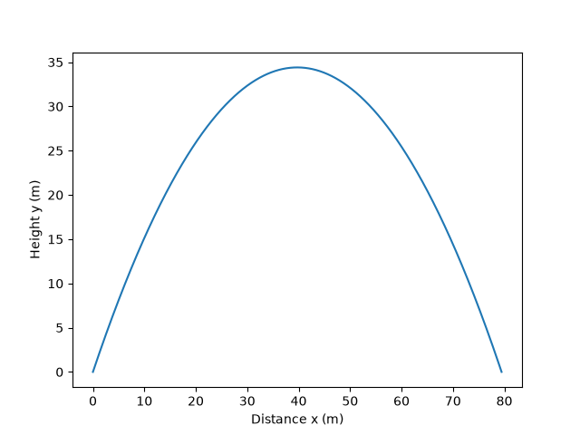

# Projectile trajectory simulation

## Problem

This program simulates a ball launched at a given speed and angle. It finds how far the ball travels, how high it gets and how long it stays in the air. It assumes no air resistance and flat ground, so the ball lands at the height it started from.

The test case is a launch at 30 m/s at 60 degrees, with g = 9.81 m/s².

## Method

**Inputs and outputs.** The program takes a launch speed `v0`, a launch angle `theta` and gravity `g`. It outputs the range R (total horizontal distance), the maximum height H and the time of flight `t`. It also plots the path of the ball.

**Time of flight.** The program finds the time to reach the top, `t_top`, from the vertical speed and gravity. The flat-ground assumption makes the path symmetrical, so the time rising equals the time falling. The total flight time is `t = 2 * t_top`.

**Drawing the curve.** `np.linspace(0, t, 10000)` makes 10000 equally spaced times from launch to landing. For each time, the code calculates how far across the ball is (`x = vx * time`) and how high it is (`y = vy * time + 0.5 * (-g) * time**2`). Plotting each `y` against its `x` joins the 10000 positions into the curve.

**Check.** The ball starts and lands at ground level. `y[0]` is the height at launch and `y[-1]` is the height at time `t`. Both printing 0.0 confirms the flight time is correct.

## Result

For the test case:

| Quantity | Program | Exact |
|---|---|---|
| Range R | 79.45 m | 79.45 m |
| Maximum height H | 34.40 m | 34.40 m |
| Time of flight t | 5.30 s | 5.30 s |

## Plot

