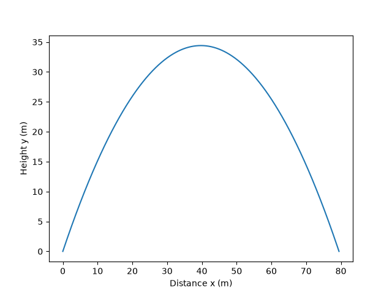
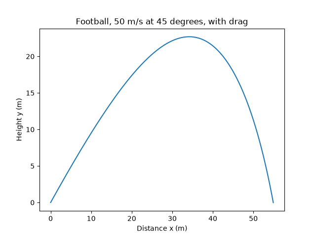

# Projectile trajectory simulation

## Problem

This project simulates a ball launched at a given speed and angle. It finds how far the ball travels, how high it gets and how long it stays in the air.

Stage 1 ignores air resistance and uses exact formulas. Stage 2 adds air resistance. That has no simple formula, so the program moves the ball forward in small time steps (Euler's method) and checks the result against the exact answer from stage 1.

## Stage 1: no air resistance

### Problem

This program simulates a ball launched at a given speed and angle. It finds how far the ball travels, how high it gets and how long it stays in the air. It assumes no air resistance and flat ground, so the ball lands at the height it started from.

The test case is a launch at 30 m/s at 60 degrees, with g = 9.81 m/s².

### Method

**Inputs and outputs.** The program takes a launch speed `v0`, a launch angle `theta` and gravity `g`. It outputs the range R (total horizontal distance), the maximum height H and the time of flight `t`. It also plots the path of the ball.

**Time of flight.** The program finds the time to reach the top, `t_top`, from the vertical speed and gravity. The flat-ground assumption makes the path symmetrical, so the time rising equals the time falling. The total flight time is `t = 2 * t_top`.

**Drawing the curve.** `np.linspace(0, t, 10000)` makes 10000 equally spaced times from launch to landing. For each time, the code calculates how far across the ball is (`x = vx * time`) and how high it is (`y = vy * time + 0.5 * (-g) * time**2`). Plotting each `y` against its `x` joins the 10000 positions into the curve.

**Check.** The ball starts and lands at ground level. `y[0]` is the height at launch and `y[-1]` is the height at time `t`. Both printing 0.0 confirms the flight time is correct.

### Result

For the test case:

| Quantity | Program | Exact |
|---|---|---|
| Range R | 79.45 m | 79.45 m |
| Maximum height H | 34.40 m | 34.40 m |
| Time of flight t | 5.30 s | 5.30 s |

### Plot

## Stage 2: with air resistance

### Problem

The program now includes air resistance. The test object is a football with air density rho = 1.225 kg/m³, drag coefficient Cd = 0.47, frontal area A = 0.038 m² and mass m = 0.43 kg. The launch is 50 m/s at 45 degrees with g = 9.81 m/s², and the time step is dt = 0.01 s.

### Method

**Inputs and outputs.** The inputs are the launch speed `v0`, the angle `theta`, gravity `g`, the drag values `rho`, `Cd`, `A` and `m`, and the step size `dt`. The outputs are the range R, the maximum height H, the time of flight `t` and a plot of the path.

**Drag.** Air pushes against the motion, and harder the faster the ball moves. The drag force is `k * v^2`, where `k = 0.5 * rho * Cd * A` and `v` is the speed. Split into horizontal and vertical parts and divided by the mass, this gives `ax = -(k/m) * v * vx` and `ay = -g - (k/m) * v * vy`. The speed changes every instant, so the drag changes every instant, and no single formula gives the path.

**Stepping forward.** The program tracks four numbers: `x`, `y`, `vx` and `vy`. At each step it works out `ax` and `ay` from the current values. Each value then becomes its old value plus `dt` times its rate of change, for example `x_new = x + vx*dt` and `vx_new = vx + ax*dt`. All four new values are worked out from the same old values before any are replaced. Each point is stored in a list, and the loop repeats until `y` is below 0.

**Landing.** The loop stops just after the ball passes through the ground, so the last point is below `y = 0`. The program draws a straight line between the last two points and finds where it crosses the ground. The fraction of the way along is `f = y_a / (y_a - y_b)`, where a is the last point above the ground and b is the first point below it. Then `R = x_a + f * (x_b - x_a)` and `t = t_a + f * dt`. H is the largest `y` in the list.

### Result

**Check with drag switched off.** With `Cd = 0` and the 50 m/s, 45 degree launch, the exact range is 254.842 m. Euler's method gets closer as the step size shrinks.

| dt (s) | Euler range (m) | Error (m) |
|---|---|---|
| 0.1 | 258.374 | 3.532 |
| 0.01 | 255.195 | 0.353 |
| 0.001 | 254.877 | 0.035 |

Each tenfold drop in `dt` cuts the error about tenfold. Euler's method is first order. It overshoots because it uses the vertical speed at the start of each step for the whole step, while the ball is slowing down during it.

**With drag switched on.** For the football:

| Quantity | No drag (exact) | With drag |
|---|---|---|
| Range R | 254.84 m | 54.90 m |
| Maximum height H | 63.71 m | 22.69 m |
| Time of flight t | 7.21 s | 4.23 s |

Drag shortens the range to about a fifth. The path is no longer symmetrical. The ball rises gently and falls steeply, and the peak is past the halfway point of the flight.

### Plot

